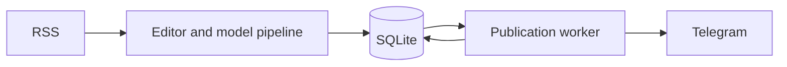

# Telegram AI Newsroom

A review-first, self-hosted pipeline that turns articles from trusted RSS/Atom sources into traceable Telegram drafts and publications.

Collect and deduplicate articles, generate and check drafts with configurable model providers, and approve or schedule posts in the editor. A separate worker delivers approved revisions and records the Telegram message ID.

## Requirements

- Python 3.12 or 3.13
- [uv](https://docs.astral.sh/uv/)

## Local setup

```bash
git clone https://github.com/ArtemYuditskiy/telegram-ai-newsroom.git
cd telegram-ai-newsroom
uv sync --all-groups
```

No API keys are required. The CLI help and test suite run without live feeds.

## Collect articles

```bash
uv run alembic upgrade head
uv run telegram-ai-newsroom feeds verify https://techcrunch.com/feed/
uv run telegram-ai-newsroom feeds approve https://techcrunch.com/feed/
uv run telegram-ai-newsroom feeds collect
```

Approval requires one extractable sample among the first five entries. Add `--host arstechnica.com` when a feed served by `feeds.arstechnica.com` points to articles on the main site. Use final HTTPS URLs. The collector checks robots rules and only fetches pages from the approved hosts.

Each run reports counts by source and reason. Candidates use text extracted from article pages. Short or unavailable articles and duplicates are recorded with their reasons. Transient article errors can be retried on the next run while the entry remains in the feed. Fetching live feeds requires an internet connection.

## Run the editorial pipeline

```bash
uv run telegram-ai-newsroom editorial eval
uv run alembic upgrade head
uv run python -m sqlite3 newsroom.db "SELECT id FROM candidates WHERE state = 'ELIGIBLE'"
uv run telegram-ai-newsroom editorial run <candidate-id> profiles.json
```

For an offline run, use `{"score": {}, "draft": {}, "review": {}}` as the contents of
`profiles.json`. This uses deterministic fixtures and writes the result to the selected database.
Use a test database for fixture runs.

Set a profile's `backend` to `gemini` and supply its `model` to use the native Gemini API.
For an OpenAI-compatible endpoint, use `openai_compatible` with a `model` and an HTTPS
`base_url`, such as `https://openrouter.ai/api/v1`. Select a model and endpoint with JSON Schema
support. Profiles independently read credentials from `GEMINI_API_KEY`, `OPENROUTER_API_KEY`,
or the environment variable named by `api_key_env`. Remote runs send article text to the
configured providers.

SQLite stores the decision, draft and review together, while the call audit records each attempt
separately. A passing model review leaves the draft pending human approval.

To compare profiles, run the same labeled dataset with each configuration:

```bash
uv run telegram-ai-newsroom editorial eval --dataset evals/editorial-smoke.json --config profiles.json
```

The report separates selection mistakes from API errors and includes the draft and reviewer
output for manual assessment. The checked-in dataset contains synthetic examples. Label agreement
measures selection only. With a remote profile, this command sends the dataset text to that API.

Use `--probe-stages` with the same dataset to exercise generation and fact review independently
of the score threshold. Generation must pass the usual local citation and link checks. The reviewer
receives a fixed draft with an intentional factual error, even if model generation failed.
Schema failures report the phase, field, and error type without printing the failed response.

Compare prompt versions on the same model and labeled cases:

```bash
uv run --env-file .env telegram-ai-newsroom editorial compare \
  evals/gemini-flash-lite.json evals/editorial-quality.json
```

The comparison runs 24 individual stage checks with at least six seconds between request starts.
It reports editorial mismatches, schema failures and other errors separately. Draft checks
confirm required details and local validation. Read the generated text against the source to
evaluate factual accuracy. The examples are synthetic and suited to regression checks.
Use `--stage review` to limit the run to reviewer cases. The smaller
`evals/editorial-fidelity.json` dataset takes 10 requests with `--candidate v4`.

The four-case offline smoke set produces two matching decisions, one false
positive, one false negative, and zero execution errors with `FakeProvider`.
The command exits with status 1 for the two intentional mismatches. This
exercises the evaluator and its reporting.

## Editor workspace

Try the workflow with a temporary database and a fake model provider:

```bash
uv run telegram-ai-newsroom web serve --demo --timezone Europe/Minsk
```

Open http://127.0.0.1:8000 and use the demo password printed in the terminal. Open a
candidate, compare it with the source, edit the post, approve the revision and schedule it.

To use an existing newsroom database, migrate it and generate an Argon2id password hash:

```bash
uv run alembic upgrade head
uv run telegram-ai-newsroom web hash-password
```

Save the hash as `NEWSROOM_ADMIN_HASH` in `.env` using single quotes, then start
the panel on loopback. Pass a profiles file to enable LLM regeneration.

```bash
uv run --env-file .env telegram-ai-newsroom web serve --local-http \
  --timezone Europe/Minsk --profiles evals/gemini-flash-lite.json
```

For HTTPS behind a reverse proxy, omit `--local-http` to use Secure session cookies.
The editor stores scheduled publication times in UTC. Delivery requires a separate worker.
Each candidate can have one active publication. Reschedule or cancel it in the candidate
card before delivery starts. To publish a different revision, cancel the old schedule
and schedule the new revision. An uncertain delivery requires reconciliation first.

Before upgrading from 0.1.0, back up the database. If the migration reports multiple
active publication IDs for a candidate, verify their delivery outcomes and resolve the
conflict in the old database before retrying the migration.

## Deliver scheduled posts

To try delivery without Telegram, schedule a post in the editor demo and pass the
temporary database path that the demo printed to the worker. Run this once the
scheduled time arrives, or omit `--once` to keep polling.

```bash
uv run telegram-ai-newsroom worker run --fake --db /tmp/newsroom-demo-EXAMPLE.db --once
```

For Telegram, add your bot as an admin with permission to post in a private test
channel. Set `NEWSROOM_TELEGRAM_TOKEN` and `NEWSROOM_TELEGRAM_CHAT_ID` (numeric ID)
in `.env`. Use one destination channel per database. Migrate the database with
`uv run alembic upgrade head`, schedule a post in the editor, and run the worker
against the same database:

```bash
uv run --env-file .env telegram-ai-newsroom worker run
```

Start the editor with the same chat ID. It records the channel on each new
schedule. For existing schedules without a destination, confirm the channel
in the editor before the worker can pick them up.

The worker records the Telegram message ID after confirmation. If Telegram
could have accepted a request before the connection dropped, the delivery is
marked `uncertain`. Compare it with the test channel before resolving it:

```bash
uv run telegram-ai-newsroom worker uncertain
uv run telegram-ai-newsroom worker resolve PUBLICATION_UUID published --message-id 123
```

Use `retry_wait` only after confirming the post is absent, or `failed` to close it
without resending. Pass `--db` to each command if you use a different SQLite file.
The candidate card shows the scheduled time, earliest retry time, and the latest
delivery reason when available. Schedules created before the upgrade may have
no recoverable original time after a retry.

## Commands

```bash
uv run telegram-ai-newsroom --help
uv run telegram-ai-newsroom --version
uv run ruff check .
uv run ruff format --check .
uv run mypy
uv run pytest
uv run pip-audit
```

Install the Git hooks once per clone:

```bash
uv run pre-commit install
uv run pre-commit run --all-files
```

## Docker smoke test

```bash
docker build -t telegram-ai-newsroom:dev .
docker run --rm telegram-ai-newsroom:dev \
  telegram-ai-newsroom db upgrade --db /data/ci.db
```

## Run with Docker Compose

Generate the admin hash with `uv run telegram-ai-newsroom web hash-password` and set
`NEWSROOM_ADMIN_HASH` in `.env`. Compose applies migrations before starting web.
The editor listens on host loopback. For remote access, put it behind an HTTPS
reverse proxy and keep the host port private.

```bash
docker compose up -d --build web
docker compose ps
```

The optional `telegram` profile starts the live worker. Enable it only after
configuring the bot and its test channel as described above.

```bash
docker compose --profile telegram up -d
```

Web and worker share the SQLite file in the named volume `newsroom-data`.
`docker compose down` preserves this volume. To enable Gemini scoring or
regeneration in the editor, set `NEWSROOM_PROFILES=/app/evals/gemini-flash-lite.json`
and `GEMINI_API_KEY` in `.env`, then recreate web.



### Diagnose and back up

`/health/live` checks the web process. `/health/ready` checks that web can open the
migrated SQLite database. It makes no model or Telegram requests. Use `db status`
to review the last feed results, model outcomes and mean latency, cost reported
by providers, and publication counts. Web request logs carry an `X-Request-ID`;
delivery logs carry publication and attempt IDs.

```bash
docker compose exec web telegram-ai-newsroom db status --db /data/newsroom.db
docker compose exec web telegram-ai-newsroom db backup /data/newsroom.db /data/snapshot.db
docker compose cp web:/data/snapshot.db ./snapshot.db
```

The SQLite backup API includes committed writes still in the WAL. The backup
command requires a new destination. To verify a restore on a separate local database:

```bash
uv run telegram-ai-newsroom db backup ./snapshot.db ./restored.db
uv run telegram-ai-newsroom db upgrade --db ./restored.db
uv run telegram-ai-newsroom db status --db ./restored.db
```

Before switching to a restored database, stop delivery and compare scheduled or
in-flight rows with the destination channel. The backup may predate posts
already delivered to Telegram.

## License

This project is licensed under the MIT License.
